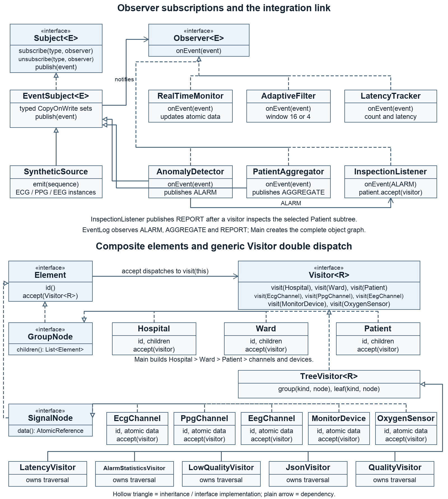

# Assignment 6 Observer and Visitor in Biomedical Signal Processing

Assem Tugelbay | SE-2540 | Variant 2

The program simulates ECG, PPG and EEG channel streams. Five listeners process each sample.
An anomaly event starts a Visitor operation on the related patient subtree and produces a REPORT event.
All values are synthetic; the amplitude threshold and quality score are demonstration rules.

## Run

Requires Java 17 or newer and Maven. Application code uses the JDK only; tests use JUnit 5.

```sh
sh run.sh
```

The default is **3 producer threads and 6000 samples**. Configure both values:

```sh
sh run.sh 4 10000
mvn test
sh run.sh benchmark 30000
```

After packaging, the equivalent benchmark command is:

```sh
java -jar target/biomedical-streams-1.0.jar benchmark 30000
```

## Observer design

`Subject<E>` and `Observer<E>` are project interfaces. `E` must expose an EventType.
`SignalEvent` is an immutable record with SAMPLE, ALARM, AGGREGATE or REPORT as its type.
Three independent SyntheticSource instances publish ECG, PPG and EEG samples.

| SAMPLE listener | Responsibility |
|---|---|
| RealTimeMonitor | Update the channel's atomic measurement snapshot |
| AnomalyDetector | Detect a synthetic amplitude above 1.0 and publish ALARM |
| AdaptiveFilter | Maintain a moving mean with a load-dependent window |
| PatientAggregator | Accumulate patient samples and republish a running mean every 25 samples |
| LatencyTracker | Count processed samples and measure end-to-end dispatch latency |

PatientAggregator is both an observer and a subject. EventLog subscribes to its AGGREGATE events.
AnomalyDetector is also an observer/subject; InspectionListener subscribes to its ALARM events.

### Push rather than pull

Every subscriber receives the immutable event value directly. It does not ask a live source for its current reading,
which may have advanced on another producer thread. Push keeps the sample and its creation timestamp together.

### Joining and leaving during callbacks

The registry is initialized eagerly with one CopyOnWriteArraySet per event type.
Publication iterates a snapshot. A listener added during a callback starts with a later publication.
A removed listener can still receive an already captured, in-flight call.
No whole-subject lock is held while callbacks run. Duplicate subscriptions do not duplicate delivery.
Exceptions are collected without skipping healthy listeners; the demo rejects a run containing listener failures.

## Adaptive processing

Each channel starts with a 16-sample moving window. Backlog >= 50 or measured dispatch delay > 5 ms selects a 4-sample window.
A later normal-load event restores 16. The mean uses only the retained samples.

The source alternates a **simulated backlog marker** between 4 and 100; it is not a measured executor queue length.
The filter also uses real elapsed nanoseconds. Tests independently force both triggers and recovery.
No samples are dropped by the source or event dispatcher.

## Composite and Visitor

The hierarchy is Hospital -> Ward -> Patient -> channel/device, four levels.
Hospital, Ward and Patient are three container types with copied, immutable child lists.
The final tree supports five leaf types: EcgChannel, PpgChannel, EegChannel, MonitorDevice and OxygenSensor.
Elements hold ids, child lists or atomic data references plus the accept hook; operations live in visitors.

| Visitor | Result |
|---|---|
| LatencyVisitor | Numeric sum of stored leaf latency |
| AlarmStatisticsVisitor | Stateful alarm total and visited-leaf count |
| LowQualityVisitor | List<Element> containing the actual low-quality leaves |
| JsonVisitor | Hand-written JSON with correctly nested children and escaped strings |
| QualityVisitor | Weighted quality total/count with an average |

The **visitor owns traversal**. Each group operation calls child.accept(this).
This lets JSON preserve nesting and lets the same operation run on one Patient without walking the hospital.
TreeVisitor centralizes overloaded dispatch hooks; each concrete visitor implements its group and leaf logic.

Double dispatch: Element.accept(visitor) selects the concrete element implementation; inside EcgChannel.accept,
this has type EcgChannel, so visitor.visit(this) selects visit(EcgChannel). The concrete visitor's leaf operation then runs.
Calling visitor.visit(element) with an Element reference cannot select a concrete overload.

## Integration

AnomalyDetector -> ALARM -> InspectionListener -> relatedPatient.accept(LatencyVisitor) -> REPORT -> EventLog.

InspectionListener receives a patient-id index and a stateless Visitor<Double> through its constructor.
It never starts traversal at Hospital. The integration test expects 10 ms for P1,
while traversing the whole hand-calculated fixture would return 20 ms.

## Concurrency and dependency boundaries

Main.build is the single application composition root. Dependencies, including ExecutorService, visitor and clock,
are passed through constructors. Patient totals, channel snapshots and filter windows are initialized before production.

- Each producer processes a disjoint slice of the same global sample sequence.
- The default has 3 producers. Benchmarks use 1, 2 and 4 while preserving the same total sample/channel mix.
- AtomicReference protects each measurement record and patient aggregate.
- LongAdder and LongAccumulator protect counters and latency statistics.
- A small synchronized block protects one filter window, not an entire subject.
- Stateful visitors are confined to one traversal. The shared inspection visitor has no mutable fields.
- Tree reads are atomic per leaf; a live whole-tree report is not a global transactional snapshot.
- ProducerRunner shuts down submissions, waits for every Future, then awaits termination.
  A failed or timed-out run is reported as an error and remaining tasks are interrupted.

The benchmark tracker measures sample creation to the final SAMPLE callback.
LatencyVisitor sums stored monitor-stage measurements; it is a separate metric.

## Measured throughput and latency

Recorded on arm64 Darwin 23.5.0, OpenJDK 21.0.1, compilation target Java 17.
Each row uses a fresh application with 3000 warmup samples followed by 30000 measured samples.
Throughput includes executor startup and shutdown. Results vary with scheduling and JIT activity.

| Producers | Samples | Samples/s | Mean latency ms | Max latency ms |
|---|---|---|---|---|
| 1 | 30000 | 975,551.60 | 0.000818 | 0.076500 |
| 2 | 30000 | 1,163,446.42 | 0.000993 | 1.603792 |
| 4 | 30000 | 1,037,505.84 | 0.003397 | 2.301291 |

Raw data: [benchmark.csv](docs/benchmark.csv). Environment and methodology: [benchmark-environment.txt](docs/benchmark-environment.txt).
Four threads need not be faster than two: sources share counters, patient snapshots and filter state.

## Tests

**28 JUnit tests pass.** The suite includes:

- typed delivery, duplicate subscription, runtime joining, self-removal and listener failure isolation;
- normal/high-load/high-latency filter cases plus recovery;
- exact latency, alarm, filter and weighted-quality values;
- JSON nesting and escaping;
- related-subtree integration;
- **4 threads x 1000 events = exactly 4000 samples per fixed counter listener**, with 160 aggregates;
- concurrent callback removal and graceful completion.

The fixture is deliberately small: leaf latencies 1, 2, 3, 4 and 10 sum to 20 ms;
alarms 2 + 1 + 0 + 0 + 4 = 7; qualities 90 + 80 + 70 + 100 + 60 average to 80.
LowQualityVisitor(80) returns P1/EEG and P2/ECG. Fixtures are fresh for each test.

## Trade-off proof commits

### Add an operation

[Add QualityVisitor without changing any element class](https://github.com/asemtygelbaeva-byte/assignment6-biomedical-observer-visitor/commit/d109c8d0089b10167b2edbfae401c9e314b0e3e6)

Files changed in the proof commit: QualityVisitor.java and Main.java.
The additional regression tests are recorded in the following test commit.
Element, GroupNode, SignalNode, every concrete element, Visitor and TreeVisitor remain unchanged.
A new operation fits the existing shape of the tree.

### Add an element type

[Add OxygenSensor and extend Visitor dispatch](https://github.com/asemtygelbaeva-byte/assignment6-biomedical-observer-visitor/commit/3bf38f01a26dbe60731c0f4aa585273da8c23d3e)

Files changed in the proof commit: OxygenSensor.java, Visitor.java, TreeVisitor.java and Main.java.
The following test commit checks the new type with all five visitors.
The new type expands the overloaded visitor contract and the common dispatch adapter.
Concrete visitors continue working because OxygenSensor uses the same Measurements model.
An unrelated element with new data would require additional logic in those operations.
Visitor becomes costly when new unrelated element types are added frequently.

Commit timestamps show the actual implementation stages. The assignment's requested two-week development history
is a separate scheduling requirement, not demonstrated by the duration of this implementation session.

## UML



Vector: [class-diagram.svg](docs/class-diagram.svg). Console example: [demo-output.txt](docs/demo-output.txt).
